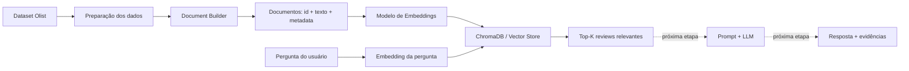

# Tech Challenge 4

## 1. Objetivo do projeto

A proposta é permitir que um usuário faça perguntas em linguagem natural sobre as avaliações de clientes da Olist, como:

- Quais são os principais problemas relacionados à entrega?
- Quais reclamações aparecem em avaliações de nota baixa?
- O que os clientes mais elogiam?
- Quais problemas aparecem com maior frequência em determinada categoria?

O sistema deverá recuperar as avaliações mais relevantes e, posteriormente, utilizar um LLM para gerar respostas fundamentadas nas evidências encontradas.

## 2. Arquitetura desenvolvida

A solução foi organizada em dois fluxos principais:

1. **Pipeline de indexação (offline):** prepara a base e constrói o índice vetorial.
2. **Pipeline de consulta (online):** recebe uma pergunta e recupera os documentos semanticamente mais próximos.



### Estrutura lógica

```text
DataFrame processado
        ↓
document_builder.py
        ↓
Documentos
{id, text, metadata}
        ↓
embeddings.py
        ↓
Vetores semânticos
        ↓
build_vector_store.py
        ↓
ChromaDB
        ↓
retriever.py
        ↓
Top-K reviews relevantes
        ↓
Prompt + LLM
        ↓
Resposta + Evidências
```

## 3. Tecnologias e bibliotecas utilizadas

### Linguagem

- **Python**

### Manipulação e preparação dos dados

- **pandas** — leitura, limpeza, joins e transformação da base.
- **numpy** — suporte a tipos numéricos e conversões auxiliares.
- **pyarrow** — leitura/escrita de arquivos Parquet.

### Embeddings

- **sentence-transformers**
- Modelo utilizado inicialmente: **`sentence-transformers/paraphrase-multilingual-MiniLM-L12-v2`**

O modelo foi escolhido como baseline por ser:

- multilíngue, incluindo português;
- leve e rápido para execução local;
- adequado para similaridade semântica entre sentenças e textos curtos;
- simples de integrar ao pipeline;
- compatível com execução em CPU.

O modelo gera embeddings de 384 dimensões.

### Vector Store

- **ChromaDB**

Foi escolhido por ser simples de executar localmente, persistente em disco e permitir armazenar, para cada documento:

- ID;
- texto original;
- metadados;
- embedding.

Além disso, permite recuperação semântica e filtros por metadata.

## 4. Estratégia utilizada para construção do pipeline RAG

A estratégia atual separa claramente as responsabilidades de cada componente.

### 4.1. Preparação dos dados

O dataset original da Olist possui informações tabulares sobre pedidos, produtos, avaliações e entregas.

O processamento transforma os dados originais em um DataFrame específico para o RAG, contendo apenas registros e campos úteis para recuperação e contextualização.

### 4.2. Construção dos documentos

Foi adotada a regra:

> **1 review = 1 documento**

Como as avaliações são curtas, não foi necessário dividir cada review em chunks menores.

Cada documento segue a estrutura conceitual:

```python
{
    "id": "R001",
    "text": "Produto chegou atrasado e com a embalagem danificada.",
    "metadata": {
        "review_score": 2,
    }
}
```

O texto é a informação utilizada para gerar o embedding. Os metadados são usados para rastreabilidade, filtros e enriquecimento da consulta.

### 4.3. Geração dos embeddings

Os textos dos documentos são transformados em vetores usando o mesmo modelo de embeddings.

```text
texto da review
      ↓
modelo de embedding
      ↓
vetor numérico
```

Exemplo conceitual:

```text
"Produto demorou muito para chegar"
              ↓
[0.031, -0.218, 0.441, ...]
```

O mesmo modelo deve ser usado depois para transformar a pergunta do usuário. Isso garante que documentos e consultas estejam no mesmo espaço vetorial.

### 4.4. Indexação na Vector Store

Os documentos e seus respectivos embeddings são armazenados no ChromaDB.

Para cada registro, a Vector Store mantém:

```text
ID
+
texto
+
metadata
+
embedding
```

### 4.5. Retrieval

A pergunta do usuário é transformada em embedding e comparada aos vetores armazenados no ChromaDB.

O sistema retorna os **Top-K documentos semanticamente mais próximos**.

Exemplo:

```text
Pergunta:
"problemas relacionados ao atraso na entrega"

↓

Possíveis resultados:
- "Meu pedido levou quase um mês para chegar."
- "Entrega realizada depois do prazo informado."
- "Ainda não recebi meu produto."
```

A recuperação é semântica, portanto não depende apenas da presença exata das mesmas palavras.


## 5. Preparação da base

### 5.1. Tratamento dos campos de texto

A base de reviews contém dois campos principais de conteúdo textual:

- `review_comment_title`
- `review_comment_message`

A estratégia adotada foi preservar informação existente em qualquer um deles.

Quando os dois campos possuem conteúdo, são concatenados para formar `review_text`.

Exemplo:

```text
Título: "Entrega ruim"
Mensagem: "Produto chegou duas semanas atrasado."

↓

review_text:
"Entrega ruim. Produto chegou duas semanas atrasado."
```

Quando apenas um dos campos existe, seu conteúdo é preservado.

Avaliações sem título **e** sem mensagem são removidas da base utilizada pelo RAG, pois não possuem conteúdo textual para indexação.

### 5.2. Reviews curtas

Não foi adotada uma regra simples baseada apenas em número mínimo de palavras.

Isso ocorre porque reviews curtas podem ser semanticamente muito úteis:

```text
"não chegou"
"produto quebrado"
"entrega atrasada"
```

Enquanto outras possuem pouco valor descritivo:

```text
"bom"
"ótimo"
"muito bom"
```

Para isso, foi utilizado uma wordlist para remover avaliações que continham exatamente e apenas essas palavras. O que reduziu cerca de 60% de avaliações genéricas e que não seriam úteis para o RAG.

Portanto, o critério é baseado em utilidade para Voice of Customer, e não apenas em tamanho.

### 5.3. Limpeza textual

A limpeza é conservadora, pois embeddings modernos funcionam melhor com o texto natural preservado.

São tratados principalmente:

- valores nulos;
- strings vazias;
- espaços duplicados;
- quebras de linha desnecessárias;
- HTML, quando presente;
- URLs sem valor semântico, quando presentes.

Não são aplicadas transformações agressivas como:

- remoção de stopwords;
- stemming;
- lematização obrigatória;
- remoção de negações;
- remoção indiscriminada de pontuação.

Isso evita alterar o significado original das avaliações.

### 5.4. Dataset processado e Vector Store são artefatos diferentes

O DataFrame processado continua existindo para análise, auditoria e reprodutibilidade.

Exemplo de estrutura:

```text
review_id
review_text
review_score
```

Os embeddings não precisam ser mantidos permanentemente no DataFrame.

A Vector Store é uma segunda representação dos mesmos registros, criada especificamente para retrieval semântico.

```text
Dataset processado
        ↓
Documentos
        ↓
Embeddings
        ↓
Vector Store
```

## 6. Principais decisões técnicas

### 6.1. Uma review por documento

As avaliações da Olist são textos curtos e representam naturalmente uma unidade independente da experiência do cliente.

Por isso, não foi aplicado chunking tradicional.

**Vantagens:**

- preserva o significado completo da avaliação;
- simplifica o pipeline;
- evita fragmentação desnecessária;
- melhora a rastreabilidade da evidência.

### 6.2. Título + mensagem

Reviews com mensagem nula não são automaticamente descartadas, pois o título isolado pode conter informação relevante.

Exemplo:

```text
"Produto não chegou"
```

Esse conteúdo é útil para recuperação mesmo sem comentário adicional.

### 6.3. Embeddings separados da estrutura do documento

O documento representa a informação original:

```text
id + texto + metadata
```

O embedding representa matematicamente esse documento.

Essa separação reduz acoplamento e facilita trocar o modelo de embeddings no futuro.

### 6.4. Modelo multilíngue

O dataset contém avaliações em português, portanto foi priorizado um modelo multilíngue.

O `paraphrase-multilingual-MiniLM-L12-v2` foi adotado como baseline devido ao bom equilíbrio entre:

- qualidade;
- velocidade;
- consumo de memória;
- facilidade de execução local.

### 6.5. ChromaDB local

Nesta etapa, não há necessidade de infraestrutura cloud ou banco vetorial gerenciado.

O ChromaDB é persistido localmente em disco, reduzindo complexidade e custo.

### 6.6. Separação entre indexação e consulta

A geração dos embeddings de todos os documentos ocorre apenas na construção/reconstrução do índice.

Não é necessário recalcular todos os embeddings a cada pergunta.

```text
Indexação:
reviews → embeddings → ChromaDB

Consulta:
pergunta → embedding → ChromaDB → Top-K
```

---

### Responsabilidades dos arquivos

| Arquivo | Responsabilidade |
|---|---|
| `document_builder.py` | Converte cada linha do DataFrame em documento RAG |
| `embeddings.py` | Carrega o modelo e gera embeddings |
| `build_vector_store.py` | Cria/persiste a collection no ChromaDB |
| `build_index.py` | Orquestra todo o pipeline de indexação |
| `retriever.py` | Vetoriza consultas e recupera os Top-K documentos |

---

## 8. Como reproduzir a solução

### 8.1. Pré-requisitos

- Python
- Git
- Acesso à internet na primeira execução para instalar dependências e baixar o modelo de embeddings

### 8.2. Criar ambiente virtual

No Windows / PowerShell:

```powershell
python -m venv .venv
```

Ativar:

```powershell
.\.venv\Scripts\Activate.ps1
```

Atualizar o `pip`:

```powershell
python -m pip install --upgrade pip setuptools wheel
```

### 8.3. Instalar dependências

```powershell
pip install -r requirements.txt
```

### 8.4. Preparar os dados

Executar os notebooks de EDA e preparação ou o pipeline equivalente para gerar:

```text
data/processed/reviews_for_rag.parquet
```

O arquivo deve conter, no mínimo:

```text
review_id
review_text
```

E pode conter metadados adicionais, como:

```text
review_score
product_category
delayed
delay_days
```


## 9. Dataset

**Brazilian E-Commerce Public Dataset by Olist**  
Disponível no Kaggle:

https://www.kaggle.com/datasets/olistbr/brazilian-ecommerce/data
