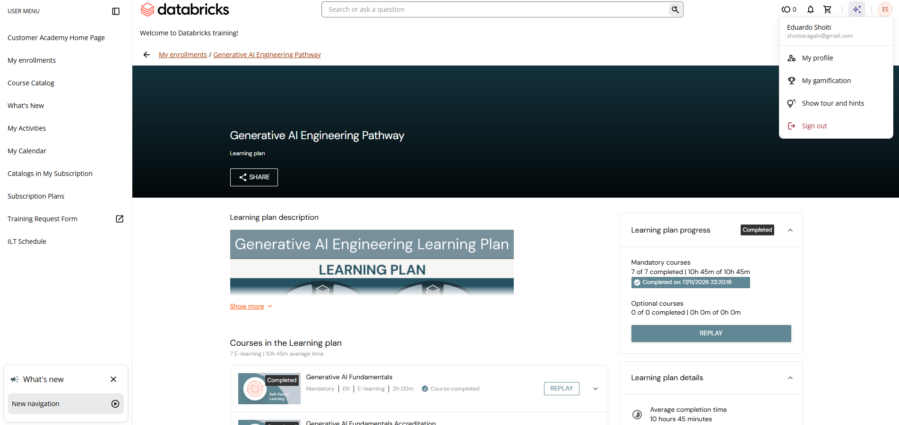
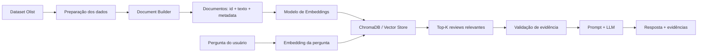

# Tech Challenge 4

Print Conclusão Trilha Databricks:


<a href="https://youtu.be/ATCn6-8lBu4" target="_blank" rel="noopener noreferrer">Vídeo do Projeto</a>

## 1. Objetivo do projeto

A proposta é permitir que um usuário faça perguntas em linguagem natural sobre as avaliações de clientes da Olist, como:

- Quais são os principais problemas relacionados à entrega?
- Quais reclamações aparecem em avaliações de nota baixa?
- O que os clientes mais elogiam?
- Quais problemas aparecem com maior frequência em determinada categoria?

O sistema recupera as avaliações mais relevantes e utiliza um LLM para gerar respostas fundamentadas nas evidências encontradas.

## 2. Arquitetura desenvolvida

A solução foi organizada em dois fluxos principais:

1. **Pipeline de indexação (offline):** prepara a base e constrói o índice vetorial.
2. **Pipeline de consulta (online):** recebe uma pergunta e recupera os documentos semanticamente mais próximos.



### Estrutura lógica

```text
DataFrame processado
        ↓
document_builder.py
        ↓
Documentos
{id, text, metadata}
        ↓
embeddings.py
        ↓
Vetores semânticos
        ↓
build_vector_store.py
        ↓
ChromaDB
        ↓
retriever.py
        ↓
Top-K reviews relevantes
        ↓
Validação de evidência
        ↓
Prompt + LLM
        ↓
Resposta + Evidências
```

## 3. Tecnologias e bibliotecas utilizadas

### Linguagem

- **Python**

### Manipulação e preparação dos dados

- **pandas** — leitura, limpeza e transformação da base.
- **numpy** — suporte a tipos numéricos e conversões auxiliares.
- **pyarrow** — leitura/escrita de arquivos Parquet.

### Embeddings

- **sentence-transformers**
- Modelo utilizado inicialmente: **`sentence-transformers/paraphrase-multilingual-MiniLM-L12-v2`**

O modelo foi escolhido como baseline por ser:

- multilíngue, incluindo português;
- leve e rápido para execução local;
- adequado para similaridade semântica entre sentenças e textos curtos;
- simples de integrar ao pipeline;
- compatível com execução em CPU.

O modelo gera embeddings de 384 dimensões.

### Vector Store

- **ChromaDB**

Foi escolhido por ser simples de executar localmente, persistente em disco e permitir armazenar, para cada documento:

- ID;
- texto original;
- metadados;
- embedding.

Além disso, permite recuperação semântica e filtros por metadata.

### LLM

- **Gemini API**
- SDK oficial **`google-genai`**
- Modelo inicial: **`gemini-3.1-flash-lite`**

O pipeline depende apenas de um contrato genérico com o método `generate(prompt)`. A integração com Gemini fica isolada em um adaptador, permitindo trocar o provedor sem alterar o retrieval, o prompt ou o restante do pipeline RAG.

#### Escolha do modelo

O `gemini-3.1-flash-lite` foi adotado como baseline porque o LLM recebe apenas uma pergunta e poucas reviews recuperadas. Sua função é sintetizar evidências em uma resposta curta, sem executar raciocínio complexo, agentes ou processamento multimodal.

Os principais motivos da escolha são:

- baixa latência para consultas interativas;
- capacidade suficiente para seguir o prompt e responder com base nas reviews;
- disponibilidade no free tier da Gemini API;
- menor custo no plano pago que modelos Flash mais avançados;
- funcionamento confirmado no projeto, enquanto o `gemini-3.8-flash` apresentou timeout durante os testes.

Na tabela de preços consultada em novembro de 2026, o `gemini-3.1-flash-lite` custa US$ 0,25 por milhão de tokens de entrada e US$ 1,50 por milhão de tokens de saída no plano pago. No free tier, entrada e saída são gratuitas dentro dos limites da conta.

Também consideramos o `gemini-2.5-flash-lite` por ser mais barato no plano pago, mas o Google limita seu acesso para novos projetos e recomenda modelos mais recentes. Por isso, o `gemini-3.1-flash-lite` oferece atualmente o melhor equilíbrio entre simplicidade, custo e qualidade esperada para este RAG.


## 4. Preparação da base

### 4.1. Tratamento dos campos de texto

A base de reviews contém dois campos principais de conteúdo textual:

- `review_comment_title`
- `review_comment_message`

A estratégia adotada foi preservar informação existente em qualquer um deles.

Quando os dois campos possuem conteúdo, são concatenados para formar `review_text`.

Exemplo:

```text
Título: "Entrega ruim"
Mensagem: "Produto chegou duas semanas atrasado."

↓

review_text:
"Entrega ruim. Produto chegou duas semanas atrasado."
```

Quando apenas um dos campos existe, seu conteúdo é preservado.

Avaliações sem título **e** sem mensagem são removidas da base utilizada pelo RAG, pois não possuem conteúdo textual para indexação.

### 4.2. Reviews curtas

Reviews curtas com duas ou mais palavras podem ser semanticamente úteis e são mantidas, por exemplo:

```text
"não chegou"
"produto quebrado"
"entrega atrasada"
```

São removidas as reviews:

- sem conteúdo textual;
- formadas por apenas uma palavra;
- que correspondem à lista de expressões genéricas definida no pipeline.

Exemplos de expressões genéricas:

```text
"bom"
"ótimo"
"muito bom"
```

Também são removidos textos duplicados, mantendo apenas a primeira ocorrência.

### 4.3. Limpeza textual

A limpeza é conservadora, pois embeddings modernos funcionam melhor com o texto natural preservado.

São tratados:

- valores nulos;
- strings vazias;
- espaços no início e no fim dos campos;
- pontuação usada na união entre título e mensagem.

Uma versão normalizada do texto é criada apenas para aplicar o filtro de expressões genéricas. O `review_text` original é preservado para a geração dos embeddings.

Não são aplicadas transformações agressivas como:

- remoção de stopwords;
- stemming;
- lematização obrigatória;
- remoção de negações;
- remoção indiscriminada de pontuação.

Isso evita alterar o significado original das avaliações.

### 4.4. Dataset processado e Vector Store são artefatos diferentes

O DataFrame processado continua existindo para análise, auditoria e reprodutibilidade.

Exemplo de estrutura:

```text
review_id
review_text
review_score
```

Os embeddings não precisam ser mantidos permanentemente no DataFrame.

A Vector Store é uma segunda representação dos mesmos registros, criada especificamente para retrieval semântico.

```text
Dataset processado
        ↓
Documentos
        ↓
Embeddings
        ↓
Vector Store
```

## 5. Estratégia utilizada para construção do pipeline RAG

A estratégia atual separa claramente as responsabilidades de cada componente.

### 5.1. Preparação dos dados

Nesta etapa, o projeto utiliza o arquivo de avaliações da Olist. O processamento transforma os títulos e comentários em um DataFrame específico para o RAG, preservando também a nota da avaliação.

### 5.2. Construção dos documentos

Foi adotada a regra:

> **1 review = 1 documento**

Como as avaliações são curtas, não foi necessário dividir cada review em chunks menores.

Cada documento segue a estrutura conceitual:

```python
{
    "id": "R001",
    "text": "Produto chegou atrasado e com a embalagem danificada.",
    "metadata": {
        "review_score": 2,
    }
}
```

O texto é a informação utilizada para gerar o embedding. Os metadados são usados para rastreabilidade, filtros e enriquecimento da consulta.

### 5.3. Geração dos embeddings

Os textos dos documentos são transformados em vetores usando o mesmo modelo de embeddings.

```text
texto da review
      ↓
modelo de embedding
      ↓
vetor numérico
```

Exemplo conceitual:

```text
"Produto demorou muito para chegar"
              ↓
[0.031, -0.218, 0.441, ...]
```

O mesmo modelo deve ser usado depois para transformar a pergunta do usuário. Isso garante que documentos e consultas estejam no mesmo espaço vetorial.

### 5.4. Indexação na Vector Store

Os documentos e seus respectivos embeddings são armazenados no ChromaDB.

Para cada registro, a Vector Store mantém:

```text
ID
+
texto
+
metadata
+
embedding
```

### 5.5. Retrieval

A pergunta do usuário é transformada em embedding e comparada aos vetores armazenados no ChromaDB.

O sistema retorna os **Top-K documentos semanticamente mais próximos**.

Exemplo:

```text
Pergunta:
"problemas relacionados ao atraso na entrega"

↓

Possíveis resultados:
- "Meu pedido levou quase um mês para chegar."
- "Entrega realizada depois do prazo informado."
- "Ainda não recebi meu produto."
```

A recuperação é semântica, portanto não depende apenas da presença exata das mesmas palavras.

Além dos resultados, o retriever calcula:

- a menor distância encontrada;
- a distância média dos três primeiros resultados;
- se há evidência suficiente de acordo com os thresholds configurados.

Atualmente são recuperadas cinco reviews por consulta. Após a calibração com o conjunto de avaliação, os limites adotados são `0.67` para a melhor distância e `0.71` para a média das três primeiras distâncias.


## 6. Principais decisões técnicas

### 6.1. Uma review por documento

As avaliações da Olist são textos curtos e representam naturalmente uma unidade independente da experiência do cliente.

Por isso, não foi aplicado chunking tradicional.

**Vantagens:**

- preserva o significado completo da avaliação;
- simplifica o pipeline;
- evita fragmentação desnecessária;
- melhora a rastreabilidade da evidência.

### 6.2. Título + mensagem

Reviews com mensagem nula não são automaticamente descartadas, pois o título isolado pode conter informação relevante.

Exemplo:

```text
"Produto não chegou"
```

Esse conteúdo é útil para recuperação mesmo sem comentário adicional.

### 6.3. Embeddings separados da estrutura do documento

O documento representa a informação original:

```text
id + texto + metadata
```

O embedding representa matematicamente esse documento.

Essa separação reduz acoplamento e facilita trocar o modelo de embeddings no futuro.

### 6.4. Modelo multilíngue

O dataset contém avaliações em português, portanto foi priorizado um modelo multilíngue.

O `paraphrase-multilingual-MiniLM-L12-v2` foi adotado como baseline devido ao bom equilíbrio entre:

- qualidade;
- velocidade;
- consumo de memória;
- facilidade de execução local.

### 6.5. ChromaDB local

Nesta etapa, não há necessidade de infraestrutura cloud ou banco vetorial gerenciado.

O ChromaDB é persistido localmente em disco, reduzindo complexidade e custo.

### 6.6. Separação entre indexação e consulta

A geração dos embeddings de todos os documentos ocorre apenas na construção/reconstrução do índice.

Não é necessário recalcular todos os embeddings a cada pergunta.

```text
Indexação:
reviews → embeddings → ChromaDB

Consulta:
pergunta → embedding → ChromaDB → Top-K
```

### 6.7. LLM desacoplado do pipeline

O pipeline recebe uma implementação de LLM pronta para uso. O adaptador `GeminiLLM` é responsável apenas pela chamada à Gemini API.

Para utilizar outro provedor, basta criar uma classe com o método `generate(prompt)` e fornecê-la ao pipeline.

---

### Responsabilidades dos arquivos

| Arquivo | Responsabilidade |
|---|---|
| `data_preparation.py` | Prepara o CSV de avaliações e gera o dataset processado |
| `config.py` | Centraliza modelo, caminhos e parâmetros do retrieval |
| `document_builder.py` | Converte cada linha do DataFrame em documento RAG |
| `embeddings.py` | Carrega o modelo e gera embeddings |
| `build_vector_store.py` | Cria/persiste a collection no ChromaDB |
| `build_index.py` | Orquestra todo o pipeline de indexação |
| `retriever.py` | Recupera os Top-K documentos e valida a evidência |
| `evaluation.py` | Executa perguntas de avaliação e resume as distâncias |
| `test_evaluation.py` | Carrega os componentes e executa a avaliação do retrieval |
| `llm.py` | Define o contrato genérico esperado de um LLM |
| `gemini_llm.py` | Adapta a Gemini API ao contrato do projeto |
| `prompts.py` | Monta o prompt com pergunta, regras e evidências |
| `rag_pipeline.py` | Orquestra retrieval, validação e geração da resposta |
| `run_rag.py` | Executa uma consulta completa pela linha de comando |

---

## 7. Avaliação do retrieval

O projeto possui um conjunto com 20 perguntas em `evaluation/retrieval_questions.json`:

- 12 perguntas dentro do escopo das avaliações;
- 8 perguntas fora do escopo;
- casos fora do escopo semanticamente próximos ao domínio, como garantia, rastreamento de pedido, estoque e cancelamento.

Para avaliar a identificação de perguntas com evidência suficiente, são calculadas `accuracy`, `precision`, `recall` e `F1`, considerando `in_scope` como a classe positiva. Os thresholds são calibrados a partir das distâncias já coletadas, sem repetir as consultas ao ChromaDB.

As perguntas válidas também possuem termos esperados. Um documento é considerado relevante quando contém ao menos um desses termos após normalização. Essa heurística simples permite calcular:

- **Hit@5:** presença de pelo menos um documento relevante nos cinco resultados;
- **Precision@5:** proporção de documentos relevantes entre os cinco resultados;
- **MRR:** posição do primeiro documento relevante.

Resultados atuais:

| Grupo de métricas | Métrica | Resultado |
|---|---|---:|
| Identificação de escopo | Accuracy | 85% |
| Identificação de escopo | Precision | 80% |
| Identificação de escopo | Recall | 100% |
| Identificação de escopo | F1 | 88% |
| Relevância do retrieval | Hit@5 | 100% |
| Relevância do retrieval | Precision@5 média | 86% |
| Relevância do retrieval | MRR | 1,0 |

Os resultados mostram que o retrieval encontra conteúdo relevante para as perguntas válidas. A principal limitação está na validação de escopo: perguntas operacionais sobre pedido, estoque ou cancelamento podem ser semanticamente próximas das reviews e passar pelos thresholds. Portanto, distância vetorial sozinha não resolve todos os casos fora do escopo.

---

## 8. Exemplos reais de perguntas e respostas

### 8.1. Exemplo 1

**Pergunta:**

> Quais principais problemas os clientes relatam?

**Resposta:**

> Com base nas avaliações fornecidas, os principais problemas relatados pelos clientes são: 
<br>**Dificuldade de comunicação e atendimento:** Os clientes apontam falta de compromisso e consideração [Review 1, Review 2], atendimento consideradopéssimo, ausência de canal para reclamações [Review 3] e grande dificuldade em contatar o fornecedor para a resolução de problemas [Review 4].
<br>**Divergência no produto:** Houve relato de recebimento de produto diferente do que foi comprado, o que gerou frustração e perda de outras oportunidades de compra [Review 5].
<br><br>Evidências recuperadas:
<br>[Review 1] nota=1 distância=0.6692
<br>Falta de compromisso com o cliente
<br><br>[Review 2] nota=1 distância=0.6769
<br>Falta de consideração com o cliente
<br><br>[Review 3] nota=1 distância=0.7725
<br>Pessimo atendimento, sem canal de reclamação 
fornecedor
<br><br>[Review 4] nota=1 distância=0.7941
<br>Há uma grande dificuldade em contactar o fornecedor para resolver qualquer problema
<br><br>[Review 5] nota=2 distância=0.8070
<br>Produto recebido divergente ao comprado, gerando frustração e perda de oferta de outras opções analisadas

### 8.2. Exemplo 2

**Pergunta:**

> Qual é a taxa Selic atual?

**Resposta:**

> Não encontrei evidências suficientes nas avaliações para responder a essa pergunta.


### 8.3. Exemplo 3

**Pergunta:**

> Qual é o telefone atual do atendimento ao cliente?

**Resposta:**

> Não há evidências suficientes para confirmar o telefone atual do atendimento ao cliente.
<br><br> Embora o [Review 5] mencione o número 4003 1000 em um relato de contato, não é possível confirmar se este é o canal oficial ou atual de atendimento. O [Review 4] cita o número 02-667550502, mas não especifica a que serviço ele pertence. O [Review 1] indica que o cliente não possui os números de contatonecessários.
<br><br> Evidências recuperadas:
<br>[Review 1] nota=1 distância=0.4769
<br>Preciso de números telefones de contato com o atendimento baratheon ou do vendedor.
URGENTE
<br><br>[Review 2] nota=5 distância=0.5892
<br>Também ligar para o cliente quando for preciso
<br><br>[Review 3] nota=5 distância=0.6322
<br>Capa de celular. Super rápido a entrega recomendar muito
<br><br>[Review 4] nota=5 distância=0.6652
<br>recomend 02-667550502 de
<br><br>[Review 5] nota=1 distância=0.6832
<br>Estpu preocupada, no status de recebimento consta como entregue dia 06/08, porem ainda não recebi o pedido. Inclusive liguei no telefone 4003 1000

---

## 9. Como reproduzir a solução

### 9.1. Pré-requisitos

- Python
- Git
- Acesso à internet na primeira execução para instalar dependências e baixar o modelo de embeddings

### 9.2. Criar ambiente virtual

No Windows / PowerShell:

```powershell
python -m venv .venv
```

Ativar:

```powershell
.\.venv\Scripts\Activate.ps1
```

Atualizar o `pip`:

```powershell
python -m pip install --upgrade pip setuptools wheel
```

### 9.3. Instalar dependências

```powershell
pip install -r requirements.txt
```

### 9.4. Preparar os dados

Executar o pipeline de preparação:

```powershell
python src/data_preparation.py
```

O comando gera:

```text
data/processed/df_reviews_rag.parquet
```

O arquivo deve conter, no mínimo:

```text
review_id
review_text
```

O metadado utilizado atualmente é:

```text
review_score
```

### 9.5. Construir o índice vetorial

Quando o dataset, o texto dos documentos ou o modelo de embeddings mudar, executar:

```powershell
python src/build_index.py
```

O índice é persistido na pasta `chroma_db/`. Não é necessário reconstruí-lo para cada consulta.

### 9.6. Executar a avaliação

Com o índice já construído, executar:

```powershell
python src/test_evaluation.py
```

O script utiliza as perguntas em `evaluation/retrieval_questions.json` e apresenta as distâncias de cada consulta e o resumo por grupo.

### 9.7. Configurar a Gemini API

Criar o arquivo local de configuração a partir do exemplo:

```powershell
Copy-Item .env.example .env
```

Preencher `GEMINI_API_KEY` no arquivo `.env` com a chave criada no Google AI Studio. O arquivo `.env` não é versionado.

O modelo pode ser alterado pela variável `LLM_MODEL_NAME`, sem mudanças no código do pipeline.

### 9.8. Executar o pipeline RAG

Com o índice vetorial já construído, executar:

```powershell
python src/run_rag.py "Quais problemas comuns de entrega?"
```

Quando não há evidência suficiente, o sistema retorna uma mensagem de fallback sem chamar o LLM. Quando há evidência, a resposta é gerada e as reviews utilizadas são exibidas em seguida.


## 10. Dataset

**Brazilian E-Commerce Public Dataset by Olist**  
Disponível no Kaggle:

https://www.kaggle.com/datasets/olistbr/brazilian-ecommerce/data

https://youtu.be/ATCn6-8lBu4
